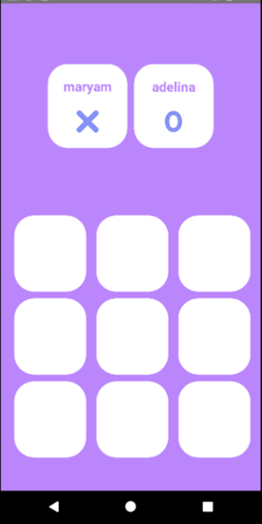
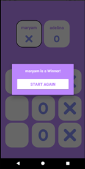

# 📱 Мобильное Android-приложение «Крестики-Нолики» с локальной базой данных

Веб-ориентированное мобильное приложение для классической игры «Крестики-нолики» на платформе Android. Проект реализует локальный мультиплеер для двух игроков на одном устройстве, содержит интерактивное управление ходами и интегрированную базу данных для персистентного хранения статистики побед.

## 🛠️ Используемый стек и архитектура

Приложение спроектировано на базе гибридного стека языков и современных Android-компонентов:
*   **Пользовательский интерфейс (UI):** Разработан на языке **Java** с применением библиотеки **Jetpack Compose** (горизонтальный пейджер) и XML-макетов разметки.
*   **База данных и логика хранения:** Реализована на языке **Kotlin** с использованием встроенных механизмов **SQLite** (`SQLiteOpenHelper`).
*   **Архитектурный шаблон:** Разделение логики по слоям взаимодействия (`UI Controller`, `LiveData`, `Repository`, `DAO`).

## 📸 Интерфейс приложения / Скриншоты

<b>Нажмите, чтобы открыть скриншоты (Click to expand)</b>

### 🔑 Экран регистрации имен игроков

### 🕹️ Главный игровой экран приложения

### 🏆 Всплывающее окно объявления результатов

### 📊 Страница статистики побед (База данных)

---

## 📁 Структура исходного кода

*   `/app/src/main/java` — Бизнес-логика приложения, обработчики нажатий и управление активностями на Java.
*   `/app/src/main/kotlin` — Модули взаимодействия с БД, хелперы и data-классы сущностей на Kotlin.
*   `/app/src/main/res` — Графические ресурсы, XML-макеты экранов, стили границ и цветовые палитры (`colors.xml`).
